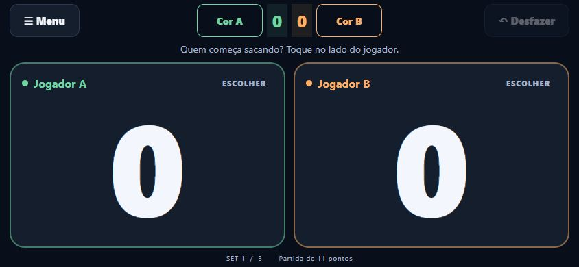
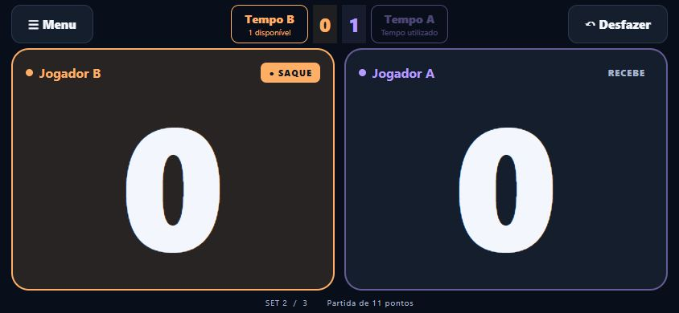
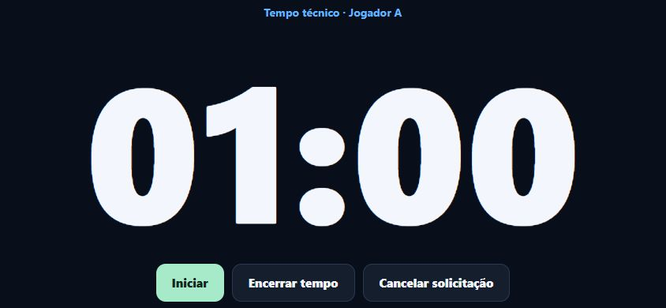
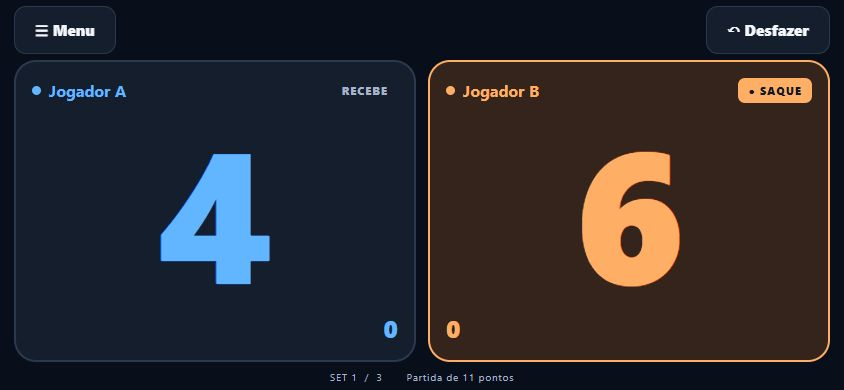
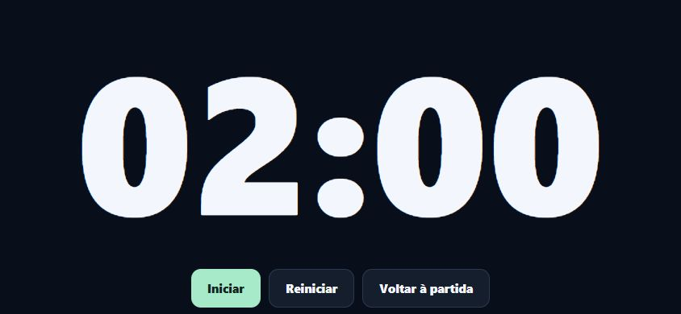
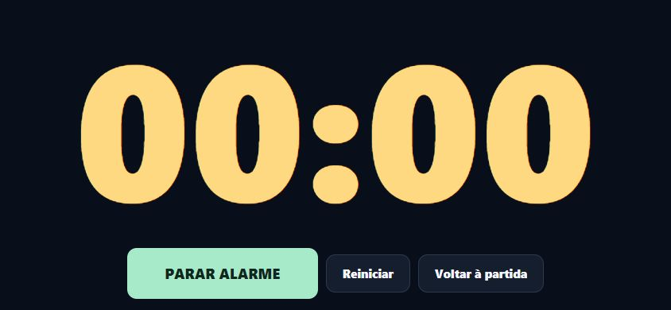
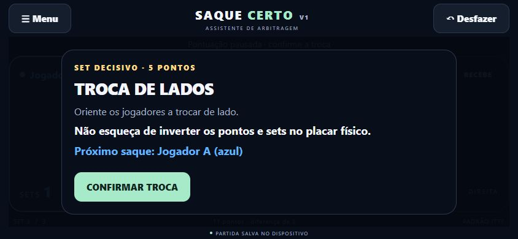

# Saque Certo · v1.2.0

Assistente de arbitragem para partidas **individuais de tênis de mesa**, feito com React Native, Expo e TypeScript. Ajuda o árbitro a identificar o próximo sacador e a confirmar as trocas de lado, principalmente aos cinco pontos do set decisivo. Complementa o placar físico.

## Executar no Windows e Android

Instale Node.js LTS e Expo Go no Android. Abra esta pasta no VS Code e use o terminal:

```powershell
npm ci
npm start
```

No Expo Go compatível com SDK 57, leia o QR Code mostrado pelo Expo, com celular e computador na mesma rede. Para alternativa por túnel: `npx expo start --tunnel`. Para reiniciar com cache limpo: `npx expo start --go --clear --port 8082`.

## Funcionalidades

- Interface minimalista em paisagem, com duas áreas grandes para marcar pontos e indicadores numéricos de sets no centro do cabeçalho.
- Jogador A azul e jogador B laranja por padrão; oito cores disponíveis, com bloqueio de combinações iguais ou muito próximas. Cores, sets e tempos acompanham os jogadores após trocar de lado.
- Primeiro toque escolhe o sacador sem marcar ponto.
- Saque a cada dois pontos e a cada ponto após 10 × 10 no formato padrão.
- Set com diferença mínima de dois; set único e melhor de 3, 5 ou 7.
- Confirmação obrigatória de troca entre sets e aos cinco do último set possível.
- Aviso com próximo sacador e lembrete explícito de inverter pontos e sets no placar físico.
- Inversão manual com confirmação; encerramento de partida com bloqueio de pontos.
- Desfazer restaura placar, sets, sacador, posições e transições.
- Partida e histórico salvos no AsyncStorage; oferta de retomada ao reabrir.
- Aquecimento de dois minutos em tela cheia, com pausa, continuação, reinício e alarme local contínuo até a intervenção do árbitro.
- Tempo técnico por jogador, com pedido individual ou simultâneo, confirmação, cronômetro próprio e recuperação ao reabrir.
- Tela mantida acesa, vibração opcional, proteção de 250 ms e alto contraste.
- Formatos casuais; alterações das regras valem para a próxima partida.
- Backup por versão em pasta externa com `npm run backup`.

## Capturas da v1

Capturas reais da versão web em janela horizontal de 844 × 390. Não são capturas de um aparelho Android.















Para capturar no Android, abra o placar em paisagem e use a combinação de captura de tela do aparelho. Registre também o aviso decisivo e a tela de aquecimento.

## Estrutura e tecnologias

```text
App.tsx                    Composição da interface e ações do árbitro
src/domain/match.ts        Motor puro de pontuação, sets, saques e histórico
src/domain/timer.ts        Cronômetro baseado em prazo absoluto
src/storage/codec.ts       Validação e serialização dos dados salvos
src/storage/persistence.ts Fila de gravação para preservar a ordem
src/hooks/useGame.ts       Recuperação, estado e AsyncStorage
src/ui/                    Placar, configurações, avisos e aquecimento
src/audio/                 Controle do alarme em repetição e cancelamento
__tests__/                 Testes Jest do domínio, persistência e alarme
scripts/backup.ps1         Backup sem sobrescrever versões anteriores
```

Expo SDK 57, React Native, TypeScript estrito, AsyncStorage, Expo Keep Awake, Expo Haptics, Expo Audio e Safe Area Context. Não há backend, autenticação, serviços de dados externos ou anúncios. O áudio é um sinal sintetizado localmente e incluído no projeto; o app não usa microfone.

## Verificações

```powershell
npm run check
npm test -- --coverage
npx expo install --check
npx expo export --platform android --platform web
```

Os relatórios detalhados e o guia de testes ficam arquivados fora do repositório, na pasta local de backups. A exportação Android valida o empacotamento JavaScript; ela não gera um APK nem substitui testes em aparelho físico.

No celular, confira principalmente a troca aos cinco pontos do set decisivo, o próximo sacador antes/depois da troca, Desfazer, retomada da partida e o alarme de aquecimento. Para testar o alarme rapidamente, configure dez segundos, inicie e aguarde 00:00: o som deve repetir até PARAR ALARME. Reiniciar deve interromper o áudio; voltar com o alarme ativo exige confirmação.

## Cores e cabeçalho

Antes de escolher o primeiro sacador, use **Cor A** e **Cor B**. A seleção é salva imediatamente. Escolher o sacador mantém 0 × 0 e substitui esses controles por **Tempo A/B**; novos sets não voltam ao pré-jogo. Os sets ficam apenas no topo, entre os controles. Os pontos permanecem brancos.

Durante a partida, as cores podem ser alteradas pelo Menu, sem mudar pontos, saque ou tempos. Não há gesto de toque longo. **Restaurar tempo técnico** aparece uma única vez: primeiro no menu durante uma partida em andamento com uso corrigível; nos demais casos, na seção Tempo Técnico. Dados antigos são migrados com as cores padrão.

## Tempo Técnico

O padrão oficial é **um tempo de até um minuto por jogador durante a partida inteira**, sem renovação a cada set. Pedidos simultâneos consomem o direito de ambos e usam um único intervalo. Referência: [ITTF Statutes 2026, itens 3.4.4.2 a 3.4.4.2.6](https://db.ittf.com/sites/default/files/public/2026-02/2026_Statutes_v1_consolidated_clean.pdf).

Após selecionar o primeiro sacador, use **Tempo A** ou **Tempo B**. Os botões mostram a disponibilidade e acompanham as posições dos jogadores. Confirme o pedido individual ou selecione **Ambos os jogadores** antes de confirmar. Só a confirmação desconta o direito; o cronômetro abre parado. Toque em **Iniciar**, pause/continue se necessário e use **Encerrar tempo** para voltar. Encerrar antecipadamente mantém o pedido consumido. Ao chegar a 00:00, o alarme repete até **ENCERRAR TEMPO**; o placar fica bloqueado durante o intervalo.

Antes do primeiro início, **Cancelar solicitação** exige confirmação e devolve o tempo. Depois do início, inclusive se pausado, uma correção só pode ser feita no Menu → **Restaurar tempo técnico** → jogador, com confirmação e sem ultrapassar o limite. O Desfazer do placar atua somente sobre pontos e ações de arbitragem: não devolve nem remove tempos técnicos.

No menu, escolha 30, 60, 120 ou 180 segundos, ou informe de 1 a 3600 segundos; a quantidade pode ser 0, 1, 2 ou 3 por jogador. As alterações valem **somente para a próxima partida**. Quantidade zero oculta os botões. Durações e quantidades alternativas são regras personalizadas para partidas informais.

Os pedidos pendentes, os usos, as correções pendentes e o cronômetro são salvos. Ao retomar, um intervalo iniciado considera o tempo transcorrido; se já tiver vencido, mostra zero e aguarda encerramento. Uma pausa continua pausada e um pedido aceito não é descontado novamente. Partidas salvas antes da funcionalidade são migradas preservando pontos, sets, lados e histórico. O relógio de aquecimento continua separado.

Para testar rapidamente, configure três segundos e dois tempos, salve e inicie nova partida. Faça um pedido conjunto: ambos devem ficar com um tempo, com um único contador parado em 00:03. Inicie, aguarde zero, encerre e confira pontos e saque. Teste também cancelar antes de iniciar, corrigir pelo menu, trocar de lados e fechar/reabrir com um intervalo pausado.

## Regras e decisões

Referência: [ITTF Statutes 2026, capítulo 2](https://db.ittf.com/sites/default/files/public/2026-02/2026_Statutes_v1_consolidated_clean.pdf), itens 2.11, 2.12 e 2.13. A escolha de quem saca primeiro é feita pelo árbitro após o sorteio; o aplicativo apenas registra o resultado.

No padrão, o alvo é 11, a vantagem mínima é dois e o saque alterna a cada dois pontos, passando a um por ponto quando ambos atingem dez. O primeiro sacador alterna entre sets. A troca no último set possível ocorre quando alguém chega a cinco. Set único também é o último set possível, portanto essa opção se aplica a ele.

O estado de troca bloqueia pontos até a confirmação e o saque é calculado por identidade. A confirmação pertence ao ponto que a originou: ao desfazer depois de confirmar, o aplicativo retorna ao estado anterior ao ponto, incluindo os lados anteriores. O árbitro deve alinhar novamente os jogadores e o placar físico quando necessário.

Nos formatos casuais, o empate que inicia os saques de um ponto é **alvo − 1**. A troca decisiva continua sendo aos cinco; alvos abaixo de cinco podem encerrar o set antes desse limiar. Formatos personalizados não representam o padrão oficial.

## Limitações da primeira versão

- Falta validação em celular Android físico, inclusive recortes, áudio, vibração e funcionamento offline. A v1 não foi homologada para torneios.
- Expo Go é o ambiente de teste. Um aplicativo Android instalado e independente exige compilação nativa; nenhum APK foi gerado nesta entrega.
- A partida funciona sem chamadas de rede após carregar. Reabrir um projeto de desenvolvimento no Expo Go pode exigir o servidor do computador; para lançamento offline independente, use uma compilação nativa.
- Apenas uma partida e seu histórico ficam armazenados; nova partida substitui a anterior após confirmação. Limpar os dados ou desinstalar o app remove esse armazenamento.
- O cronômetro não é recuperado após sair da tela de aquecimento ou fechar o app. A partida permanece intacta. O alarme respeita volume, modo silencioso, saída de áudio e restrições do aparelho; o app não altera o volume global. Não há garantia de reprodução em segundo plano, com a tela bloqueada ou com o app encerrado. Mantenha o app em primeiro plano durante o aquecimento.
- O histórico usa snapshots completos; partidas excepcionalmente longas aumentam o armazenamento.
- Dependências transitivas de desenvolvimento têm alertas conhecidos; consulte `npm audit` para verificar o estado atual.
- Fora do escopo: duplas, sistema de aceleração, placares eletrônicos, ranking, torneios, contas e sincronização online.

## Próximos passos

Validar no dispositivo físico, ajustar o visual a partir do uso real e da imagem de referência, gerar o instalador Android e adicionar nomes personalizados e exportação do histórico, se desejado.

Repositório: [leomacedo2/saque-certo](https://github.com/leomacedo2/saque-certo). Uma licença de distribuição ainda pode ser escolhida pelo autor.
